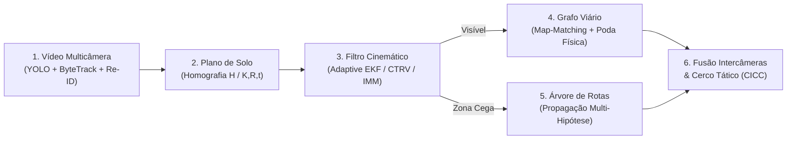

# Planejamento de Engenharia e Pesquisa (`PLANEJAMENTO.md`)

## 1. Objetivo do Sistema

Rastrear veículos suspeitos em redes de câmeras urbanas **esparsas e sem sobreposição visual** (_non-overlapping FOVs_). Quando o alvo sai do campo de visão de uma câmera e entra em uma **zona cega**, o sistema:

1. Propaga posição e incerteza com dinâmica veicular não linear (**EKF**);
2. Restringe as trajetórias à malha viária da cidade (**Map-Matching em Grafo Direcionado**);
3. Calcula a **Árvore de Rotas de Fuga Prováveis** e recomenda **Pontos de Bloqueio Policial (Cerco CICC)**;
4. Reidentifica o veículo em outra câmera (**Associação Espaço-Temporal + Re-ID Visual / Placa**) e reconstrói a rota percorrida na zona cega (**Backtracking Forense**).



---

## 2. O Que Já Está Feito (Base `v2.0` no Repositório)

O núcleo matemático em `pipeline/` já foi refatorado, possui **14 testes unitários e de integração aprovados** (`tests/test_pipeline.py`) e **5 experimentos de ablação automatizados** (`pipeline/experiments.py` -> `ablation_results.json`).

| Módulo                                          | Referência Científica                                             | Status e Funcionalidades Prontas                                                                                                                                                                                                                                                                                                                                            |
| :---------------------------------------------- | :---------------------------------------------------------------- | :-------------------------------------------------------------------------------------------------------------------------------------------------------------------------------------------------------------------------------------------------------------------------------------------------------------------------------------------------------------------------- |
| `pipeline/geometry.py`                          | _Chilgunde et al. (2004)_<br>_Bradler et al. (2021)_              | • Homografia planar $\mathbf{H}$ via DLT normalizado e calibração 3D ($\mathbf{K}, \mathbf{R}, \mathbf{t}$);<br>• Covariância métrica no solo $\mathbf{R}_k = \mathbf{J}\mathbf{\Sigma}_{\text{px}}\mathbf{J}^T$;<br>• Correção de perspectiva 3D da bounding box (**-74,3% de erro de projeção no solo**).                                                                 |
| `pipeline/kinematics.py`<br>`pipeline/ekf.py`   | _Lou et al. (2002)_<br>_Bradler et al. (2021)_<br>_Kalman (1960)_ | • 5 filtros implementados na mesma interface: `AdaptiveEKF` (_Two-Point-Bicycle_ com fator de desvanecimento $\lambda_k$), `CanonicalBicycleEKF` ($\lambda=1$), `CoordinatedTurnEKF` (CTRV), `LinearKalmanCV` e `IMMFilter`;<br>• Redução de **76,7% no RMSE em curvas evasivas** frente ao Filtro de Kalman Linear.                                                        |
| `pipeline/roadgraph.py`                         | _Chao et al. (2020)_<br>_Kinderby & Ridderstolpe (2024)_          | • Grafo direcionado com interpolação curvilínea `point_at_s(s)`;<br>• Poda física por **velocidade crítica de curva** ($v_{\text{crit}} = \sqrt{\mu \cdot g \cdot R_{\text{curva}}}$) e raio mínimo de giro;<br>• **Propagador Multi-Hipótese** na zona cega (`propagate_route_tree`);<br>• Map-Matching **HMM/Viterbi** e recomendação de **Pontos de Bloqueio Policial**. |
| `pipeline/reid.py`<br>`pipeline/association.py` | _Chilgunde et al. (2004)_<br>_VeRi-776 / Zhang et al. (2025)_     | • Extrator de aparência `VehicleReIDExtractor` (HSV em 3 faixas + HOG normalizado em L2);<br>• 4 modos de associação intercâmeras (`article`, `chi2`, `reid_only`, `hybrid`) + **Backtracking Forense** da rota na zona cega (**IDF1 = 1.00 no benchmark sintético**).                                                                                                      |
| `pipeline/video.py`<br>`pipeline/pipeline.py`   | _Medeiros et al._ (§5.3)                                          | • Pipeline **100% causal** em tempo real (sem leitura de frames futuros);<br>• Leitura de MP4/RTSP/HLS + `YOLODetector` + rastreador local em 2 estágios (**ByteTrack + Re-ID**).                                                                                                                                                                                           |

---

## 3. O Que Precisa Melhorar (Gargalos Identificados nos Testes)

A bateria de experimentos (`ablation_results.json`, `kitti_result.json` e `anpr_result.json`) revelou **5 pontos técnicos** que a equipe precisa aprimorar no código:

1. **Estabilizar o Fator de Desvanecimento $\lambda_k$ sob Ruído Alto (`pipeline/ekf.py`)**:
   - **Problema (Experimento A2):** Com ruído de detecção alto ($\sigma \ge 1.0\text{ m}$), a orientação $\theta$ calculada por $\text{atan2}(\Delta Y, \Delta X)$ sofre _jitter_. Como o peso de _Lou et al. (2002)_ para orientação é muito alto ($\alpha_\theta = 2.8$), o filtro confunde ruído de caixa com manobra brusca e infla $\lambda_k > 20$ desnecessariamente.
   - **Solução:** Suavizar $\theta_{\text{obs}}$ em janela deslizante de 4 frames, adaptar $\alpha_\theta$ conforme a velocidade e exigir que a inovação normalizada (NIS) supere o limiar $\chi^2_{95\%}$ por 2 frames seguidos antes de ativar $\lambda_k > 1$.
2. **Separar Oclusão Local de Entrada em Zona Cega (`pipeline/pipeline.py`)**:
   - **Problema (`kitti_result.json`):** Perdas de detecção de $0.3\text{ s}$ no meio da imagem estavam sendo tratadas como entrada em zona cega intercâmeras (`cross_camera: false`).
   - **Solução:** Definir **Zonas de Saída (_Exit Zones_)** nas bordas da imagem/via. O veículo só entra no estado `"blind"` (disparando árvore de rotas e associação multicâmera) quando sai pelas bordas do campo de visão da câmera. Oclusões curtas no centro da imagem ficam restritas ao buffer do rastreador local (`ByteTrack`).
3. **Substituir Re-ID de Histograma por Modelo Deep Learning Pré-Treinado (`pipeline/reid.py`)**:
   - **Problema:** Histogramas HSV+HOG confundem veículos de cores neutras (prata, branco, preto, cinza) sob variações de iluminação entre câmeras reais.
   - **Solução:** Integrar pesos pré-treinados de Re-ID veicular (**OSNet** ou **ResNet50-IBN** treinados no **VeRi-776 / CityFlow** via PyTorch ou ONNX Runtime), mantendo o HSV+HOG apenas como fallback leve.
4. **Perfil de Frenagem em Curva na Zona Cega (`pipeline/roadgraph.py`)**:
   - **Problema:** `propagate_along_route()` propaga o veículo na zona cega com velocidade escalar constante.
   - **Solução:** Desacelerar a hipótese até $v_{\text{crit}}$ ao passar por conversões de $\Delta\theta > 30^\circ$ e reacelerar após a esquina, melhorando a precisão do tempo estimado de chegada (ETA) na câmera seguinte.
5. **Auto-Calibração das Constantes de Escala $C_w^{12}, C_l^{12}$ (`pipeline/association.py`)**:
   - **Problema:** As constantes de proporcionalidade de largura/comprimento entre câmeras (_Chilgunde et al., 2004_) estão fixas em `1.0`.
   - **Solução:** Calcular automaticamente a razão mediana das dimensões projetadas por câmera.

---

## 4. O Que Ainda Falta Construir (Novos Módulos e Datasets)

Para validar o projeto em cenários urbanos reais e entregar a demonstração final do artigo, faltam **5 entregas**:

1. **Importador de Malha Viária Real do OpenStreetMap (`pipeline/osm_loader.py`)**:
   - Baixar o grafo viário real de qualquer coordenada GPS / bairro (via `OSMnx` ou API Overpass / GeoJSON), converter de `lat/lon` (WGS84) para **metros (UTM)** e importar geometria real das curvas, sentidos de via (`oneway`), velocidades (`maxspeed`) e número de faixas (`lanes`).
2. **Integração com Datasets Públicos Reais (`scripts/prepare_datasets.py`)**:
   - **CityFlow / CityFlowV2 (AI City Challenge Track 1/3) & RoundaboutHD:** Benchmark principal para rastreamento multicâmera real com câmeras fixas não sobrepostas e homografia GPS;
   - **UA-DETRAC:** Vídeos reais de câmeras de vigilância fixas em cruzamentos (aplicar máscara artificial de zona cega de 3 a 8 segundos no meio do vídeo para avaliar o erro em metros do EKF contra o _ground-truth_ real);
   - **VeRi-776:** Validação da acurácia do modelo de Re-Identificação visual entre 20 câmeras;
   - **Roboflow Universe / Kaggle:** Vídeos complementares de CFTV urbano e leitura de placas.
3. **Módulo de Leitura de Placas / OCR (`pipeline/alpr.py`)**:
   - Conforme a Seção 5.4 do artigo (_Densidade da Malha Viária_), integrar OCR de placas leve (ex: `EasyOCR` / `PaddleOCR` / `fast-alpr`) para zerar a incerteza do filtro e garantir associação exata quando a placa for visível.
4. **Ferramenta de Calibração Homográfica (`pipeline/calibrator.py`)**:
   - Script onde o operador seleciona $\ge 4$ pontos no frame da câmera e os pontos correspondentes no mapa UTM/OSM para gerar e validar automaticamente o arquivo `calib/<camera_id>.txt`.
5. **Dashboard e Vídeo Tático CICC (`pipeline/visualizer.py`)**:
   - Renderizador _Split-Screen_ mostrando:
     - **Lado Esquerdo:** Câmeras sincronizadas com caixas, IDs globais, velocidade estimada em km/h e status (`VISÍVEL` / `ZONA CEGA`);
     - **Lado Direito (Mapa 2D da Cidade):** Grafo viário com a posição dos veículos, **elipse de covariância $\mathbf{P}_k$ do EKF** expandindo na zona cega, **Árvore de Rotas de Fuga** colorida por probabilidade e **Pontos de Bloqueio Policial** recomendados com ETA.

---

## 5. Divisão de Tarefas (Roadmap em 4 Sprints)

### Sprint 1 — Robustez do EKF e Cinemática na Zona Cega

- [ ] Implementar filtro deslizante de orientação $\theta_{\text{obs}}$, pesos $\alpha$ dinâmicos e gatilho NIS ($\chi^2$) para estabilizar $\lambda_k$ sob ruído alto (`pipeline/ekf.py`).
- [ ] Implementar _Exit Zones_ para separar oclusão local intra-câmera de transição real para zona cega (`pipeline/pipeline.py`).
- [ ] Adicionar perfil de frenagem/reaceleração em esquinas na propagação cega (`pipeline/roadgraph.py`) e auto-calibração de $C_w^{12}, C_l^{12}$ (`pipeline/association.py`).

### Sprint 2 — Mapas Reais (OpenStreetMap) e Calibração

- [ ] Criar `pipeline/osm_loader.py` para converter mapas reais do OpenStreetMap em `RoadGraph` métrico (UTM).
- [ ] Criar `pipeline/calibrator.py` para gerar matrizes de homografia $\mathbf{H}_i$ de câmeras reais a partir de pontos de controle no mapa.

### Sprint 3 — Deep Re-ID, OCR de Placas e Benchmarks Reais

- [ ] Integrar pesos pré-treinados de Deep Re-ID (`OSNet` / `ResNet50-VeRi` via ONNX/PyTorch) em `pipeline/reid.py`.
- [ ] Implementar módulo opcional de leitura de placas `pipeline/alpr.py`.
- [ ] Criar `scripts/prepare_datasets.py` e rodar avaliação nos datasets reais (**UA-DETRAC** com máscara de zona cega, **VeRi-776** e **CityFlowV2 / RoundaboutHD**).

### Sprint 4 — Visualização CICC e Resultados Finais do Artigo

- [ ] Construir `pipeline/visualizer.py` para gerar o vídeo demonstrativo _Split-Screen_ (Câmeras + Mapa Tático CICC com elipses EKF, árvore de fuga e pontos de cerco).
- [ ] Gerar gráficos científicos (`matplotlib`) dos Experimentos A1–A5 e consolidar tabelas finais para o artigo.

---

## 6. Comandos Rápidos para a Equipe

```bash
# 1. Executar todos os testes automatizados (14 testes)
python -m unittest discover -s tests -v

# 2. Rodar os 5 Experimentos Científicos de Ablação (gera ablation_results.json)
python -m pipeline.cli experiments --out ablation_results.json

# 3. Gerar dataset multicâmera sintético e testar a pipeline híbrida
python -m pipeline.cli demo --root data/cityflow_demo
python -m pipeline.cli run --data data/cityflow_demo --assoc-mode hybrid --filter-model adaptive_bicycle --out resultado.json

# 4. Processar vídeos reais com YOLO + ByteTrack + Re-ID + EKF + Grafo
python -m pipeline.cli video --sources kitti_inference.mp4 --calib-dir calib --graph grafo_demo.json --weights weights/yolov8n.pt --out kitti_result.json
```
