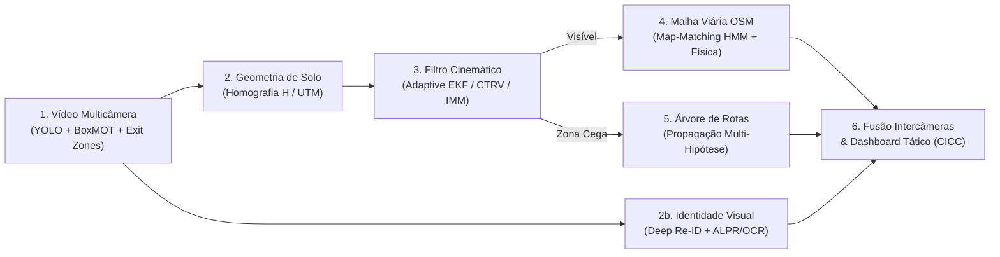

# Planejamento de Engenharia e Pesquisa — Construção do Zero (`PLANEJAMENTO.md`)

> **Status do Projeto:** Reiniciado do zero (`v0.0` — Greenfield). Todo o código legado foi removido para construir uma arquitetura limpa, modular e orientada a ferramentas *open-source* consolidadas, incorporando desde o início as correções matemáticas e de engenharia identificadas na pesquisa.

---

## 1. Objetivo do Sistema

Rastrear veículos suspeitos em redes de câmeras urbanas **esparsas e sem sobreposição visual** (_non-overlapping FOVs_). Quando o alvo sai do campo de visão de uma câmera e entra em uma **zona cega**, o sistema:

1. **Detecta e rastreia localmente** o veículo em cada câmera, distinguindo oclusões temporárias de saídas reais do campo de visão (_Exit Zones_);
2. **Projeta o veículo no plano do solo em metros (UTM)** usando calibração homográfica / 3D e propagação de covariância métrica;
3. **Propaga posição e incerteza** com dinâmica veicular não linear (**EKF Adaptativo / CTRV / IMM**) estabilizado contra ruído de detecção;
4. **Restringe as trajetórias à malha viária real (OpenStreetMap)** usando Map-Matching (HMM/Viterbi) e física de curvas;
5. **Calcula a Árvore de Rotas de Fuga Prováveis** na zona cega (com perfil de frenagem em esquinas) e recomenda **Pontos de Bloqueio Policial (Cerco CICC)** com ETA;
6. **Reidentifica o veículo** em outras câmeras combinando **Associação Espaço-Temporal + Deep Re-ID Visual + OCR de Placas (ALPR)** e reconstrói a rota na zona cega (**Backtracking Forense**).



---

## 2. Stack de Ferramentas Open-Source

Em vez de reimplementar componentes de visão computacional e geoprocessamento do zero, o projeto adota bibliotecas *open-source* maduras e foca o desenvolvimento autoral no **núcleo científico** (EKF adaptativo, propagação na zona cega, fusão espaço-temporal e recomendação de cerco).

| Etapa da Pipeline | Ferramentas Open-Source Recomendadas | Papel no Sistema |
| :--- | :--- | :--- |
| **Detecção de Veículos** | **[Ultralytics YOLO](https://github.com/ultralytics/ultralytics)** (YOLOv8 / YOLO11) ou **RT-DETR** | Detecção em tempo real de carros, motos, ônibus e caminhões (com exportação ONNX/TensorRT). |
| **Rastreamento Local (SCT)** | **[BoxMOT](https://github.com/mikel-brostrom/boxmot)** (ByteTrack, BoT-SORT, DeepOC-SORT) | Rastreamento multi-objeto intra-câmera plugável, com suporte nativo a embeddings de aparência e compensação de movimento. |
| **Deep Vehicle Re-ID** | **[FastReID](https://github.com/JDAI-CV/fast-reid)** (JDAI-CV) e **[TorchReID](https://github.com/KaiyangZhou/deep-person-reid)** (OSNet / ResNet50-IBN) | Extração de vetores de aparência ($L_2$-normalizados) treinados no **VeRi-776 / CityFlow**, exportáveis para **ONNX Runtime**. |
| **Leitura de Placas (ALPR/OCR)** | **[fast-alpr](https://github.com/ankandrew/fast-alpr)** (ONNX), **[FastANPR](https://github.com/Pandede/FastANPR)** ou **YOLO + [PaddleOCR](https://github.com/PaddlePaddle/PaddleOCR)** | Detecção e leitura de placas (incluindo padrão brasileiro e Mercosul) para associação determinística quando visíveis. |
| **Geometria & Calibração** | **OpenCV** (`cv2.findHomography`, `cv2.calibrateCamera`), **PyProj** / **Shapely** | Projeção pixel $\to$ solo (DLT / RANSAC), conversão WGS84 $\leftrightarrow$ UTM em metros e polígonos de *Exit Zones*. |
| **Filtros Cinemáticos (EKF/IMM)** | **NumPy / SciPy** + referência **[FilterPy](https://github.com/rlabbe/filterpy)** / **[Stone Soup](https://github.com/dstl/Stone-Soup)** | Implementação limpa e vetorizada de `AdaptiveEKF` (Two-Point Bicycle), `CTRV`, `LinearCV` e `IMM` com gatilho NIS ($\chi^2$). |
| **Malha Viária & Map-Matching** | **[OSMnx](https://github.com/gboeing/osmnx)**, **NetworkX**, **[LeuvenMapMatching](https://github.com/wannesm/LeuvenMapMatching)** (HMM/Viterbi) | Download de mapas reais do OpenStreetMap já projetados em UTM, com sentidos (`oneway`), velocidades (`maxspeed`) e faixas (`lanes`). |
| **Referências MTMC** | **[fubel/stmc](https://github.com/fubel/stmc)**, **[regob/vehicle_mtmc](https://github.com/regob/vehicle_mtmc)**, **[Fast_Online_MTMCT](https://github.com/kamkyu94/Fast_Online_MTMCT)** | Referências abertas de associação global intercâmeras (grafos espaço-temporais, multi-cuts e métricas IDF1/MOTA/HOTA). |
| **Visualização & Vídeo CICC** | **[Supervision](https://github.com/roboflow/supervision)** (Roboflow), **OpenCV**, **Matplotlib / Folium** | Anotação rápida de bounding boxes/trilhas, renderização *Split-Screen* (câmeras + mapa 2D tático com elipses de covariância). |
| **Simulação & Geração de Dados** | **[CARLA Simulator](https://carla.org/)** | Criação de cenários controlados de fuga urbana com câmeras não sobrepostas, mapas OpenDRIVE e *ground-truth* exato. |

---

## 3. Bancos de Dados (Datasets) Alinhados à Lógica da Pipeline

Os datasets abaixo foram selecionados por reproduzirem exatamente a estrutura do sistema (**câmeras fixas urbanas sem sobreposição, calibração/homografia, zonas cegas, Re-ID veicular e placas**):

| Dataset | Aderência à Pipeline | O Que Contém | Uso no Projeto |
| :--- | :--- | :--- | :--- |
| **[CityFlow / CityFlowV2](https://www.aicitychallenge.org/)** *(AI City Challenge)* | **100% (Principal Real)** | Vídeos sincronizados de **40–46 câmeras reais** em cruzamentos urbanos (muitos sem sobreposição), **matrizes de homografia (`calibration.txt`) pixel $\to$ GPS**, timestamps e IDs globais. | Validação *end-to-end* da pipeline completa (EKF + OSM + Re-ID + Associação Intercâmeras). |
| **[Synthehicle](https://github.com/fubel/synthehicle)** *(WACV 2023 / CARLA)* | **100% (Principal Sintético)** | **17 horas de vídeo**, 64 cenas, **340 câmeras** (sobrepostas e **não sobrepostas**), 4 climas (dia, chuva, amanhecer, noite), **homografia/calibração exata**, caixas 2D/3D e coordenadas mundiais perfeitas. | Treinamento e ablação controlada do EKF, propagação em zona cega e calibração sem ruído de GPS. |
| **[VeRi-776](https://github.com/JDAI-CV/VeRi)** | **Re-ID Multicâmera** | **50.000+ imagens** de 776 veículos em **20 câmeras urbanas** ($1\text{ km}^2$), com topologia de câmeras, timestamps e caixas de placas. | Treino/avaliação do modelo **Deep Re-ID** (OSNet / ResNet50-IBN) entre câmeras distintas. |
| **[VERI-Wild](https://github.com/PKU-IMRE/VERI-Wild)** | **Re-ID em Larga Escala** | **400.000+ imagens** de 40.000 veículos em **174 câmeras** ($200\text{ km}^2$) ao longo de 1 mês (dia/noite, clima severo). | Teste de robustez do Re-ID sob variações extremas de iluminação e longos intervalos de tempo. |
| **[UA-DETRAC](https://detrac-db.rit.albany.edu/) & VRIC** | **CFTV Fixo + Máscara Cega** | 10h de CFTV urbano real em 24 cruzamentos (UA-DETRAC) e recortes multi-câmera com blur/baixa resolução (VRIC). | Aplicar **máscara artificial de zona cega (3–8 s)** no meio do vídeo para medir o RMSE (em metros) do EKF contra o *ground-truth*. |
| **[RodoSol-ALPR](https://github.com/raysonlaroca/rodosol-alpr-dataset) & [UFPR-ALPR](https://github.com/raysonlaroca/ufpr-alpr-dataset)** | **ALPR Brasil / Mercosul** | **20.000 imagens** de carros e motos com placas **brasileiras antigas e Mercosul** (RodoSol) + 4.500 frames urbanos (UFPR). | Validação e ajuste fino do módulo de leitura de placas (`alpr.py`) para o cenário brasileiro (CICC). |

---

## 4. Requisitos Arquiteturais (Lições Incorporadas Desde o Dia 1)

Para não repetir gargalos de versões anteriores, o novo código nasce com os seguintes requisitos obrigatórios:

1. **Estabilidade do Fator de Desvanecimento $\lambda_k$ no EKF:**
   - Suavização circular de $\theta_{\text{obs}}$ em janela deslizante (4 frames);
   - Peso $\alpha_\theta(v)$ adaptativo conforme a velocidade (evitando explosão de ruído em baixas velocidades);
   - Ativação de $\lambda_k > 1$ condicionada a **gatilho NIS ($\chi^2_{95\%}$)** persistente por $\ge 2$ frames consecutivos.
2. **Separação Explícita entre Oclusão Local e Zona Cega (*Exit Zones*):**
   - Cada câmera define polígonos de *Exit Zones* nas bordas do FOV / saídas de via;
   - Oclusões curtas no centro da imagem permanecem no rastreador local (`BoxMOT`); apenas saídas pelas *Exit Zones* disparam o estado `"blind"` e a árvore de rotas.
3. **Deep Re-ID como Padrão (ONNX):**
   - Embeddings de 512 dimensões via **OSNet / ResNet50-IBN (VeRi-776)** em ONNX Runtime, com distância cosseno. Histograma HSV+HOG fica apenas como fallback de teste unitário offline.
4. **Física Realista na Propagação Cega:**
   - Cálculo de velocidade crítica em curva $v_{\text{crit}} = \sqrt{\mu \cdot g \cdot R_{\text{curva}}}$;
   - Perfil de desaceleração antes de esquinas ($\Delta\theta > 30^\circ$) e reaceleração até `maxspeed` da via para precisão do ETA.
5. **Auto-Calibração de Escala Intercâmeras ($C_w^{ij}, C_l^{ij}$):**
   - Estimativa automática pela razão mediana das dimensões projetadas no solo entre pares de câmeras.
6. **Causalidade Estrita (Tempo Real):**
   - Toda a inferência e fusão processa estritamente até o instante $t$ (sem acesso a frames futuros).

---

## 5. Estrutura Alvo do Repositório (Do Zero)

```text
Pipeline_IA/
├── configs/                  # Arquivos YAML de câmeras, hiperparâmetros e cenários
├── data/                     # Datasets baixados/preparados (ignorado no git)
├── weights/                  # Pesos YOLO, OSNet/FastReID (.onnx) e ALPR (ignorado no git)
├── scripts/
│   ├── prepare_datasets.py   # Download/conversão de CityFlow, Synthehicle, VeRi-776, UA-DETRAC
│   ├── calibrate_camera.py   # Ferramenta interativa para gerar homografia H (imagem <-> UTM)
│   └── run_benchmarks.py     # Experimentos de ablação (A1–A5) e geração de gráficos
├── src/
│   └── tracker/
│       ├── config.py         # Dataclasses/Pydantic de configuração
│       ├── geometry.py       # Homografia H, calibração 3D, covariância R_k e correção bbox
│       ├── kinematics.py     # Modelos de movimento (Two-Point Bicycle, CTRV, CV)
│       ├── ekf.py            # AdaptiveEKF (com NIS + suavização), CanonicalEKF, CTRV, IMM
│       ├── osm_loader.py     # Importador OpenStreetMap -> Grafo métrico UTM (OSMnx)
│       ├── roadgraph.py      # Map-Matching (HMM/Viterbi), propagação cega com frenagem, cerco
│       ├── detector.py       # Wrapper Ultralytics YOLO + BoxMOT + Exit Zones
│       ├── reid.py           # Extrator Deep Re-ID (ONNX / FastReID / OSNet)
│       ├── alpr.py           # Módulo opcional de leitura de placas (fast-alpr / PaddleOCR)
│       ├── association.py    # Fusão espaço-temporal + Re-ID + ALPR + Backtracking Forense
│       ├── pipeline.py       # Orquestrador multicâmera causal em tempo real
│       └── visualizer.py     # Renderizador Split-Screen CICC (câmeras + mapa 2D tático)
├── tests/                    # Testes unitários e de integração (pytest)
├── pyproject.toml            # Dependências e configuração do projeto
└── PLANEJAMENTO.md
```

---

## 6. Roadmap de Desenvolvimento (Do Zero em 5 Sprints)

### Sprint 0 — Fundação, Ambiente e Datasets
- [ ] Configurar `pyproject.toml` / `requirements.txt` limpo e estrutura `src/tracker/` + `tests/` (`pytest`).
- [ ] Criar `scripts/prepare_datasets.py` com suporte inicial a **Synthehicle** (amostra), **CityFlow** e **UA-DETRAC** (com gerador de máscara de zona cega).

### Sprint 1 — Geometria, Cinemática e EKF Estabilizado
- [ ] Implementar `geometry.py` (DLT normalizado, projeção 3D/homografia, propagação de covariância $\mathbf{R}_k = \mathbf{J}\mathbf{\Sigma}_{\text{px}}\mathbf{J}^T$).
- [ ] Implementar `kinematics.py` e `ekf.py` (`AdaptiveEKF` com suavização de $\theta_{\text{obs}}$ + gatilho NIS $\chi^2$, `CTRV`, `LinearCV`, `IMM`).
- [ ] Validar com testes unitários e benchmark de ruído ($\sigma = 0.2\text{ m}$ a $1.5\text{ m}$).

### Sprint 2 — Malha Viária Real (OSM), Propagação Cega e Calibração
- [ ] Implementar `osm_loader.py` com `OSMnx` (WGS84 $\to$ UTM, `oneway`, `maxspeed`, geometria de curvas).
- [ ] Implementar `roadgraph.py` (Map-Matching HMM/Viterbi, poda por $v_{\text{crit}}$, frenagem/reaceleração em curvas na zona cega, árvore de rotas e recomendação de bloqueio CICC).
- [ ] Criar `scripts/calibrate_camera.py` (seleção de $\ge 4$ pontos vídeo $\leftrightarrow$ mapa UTM).

### Sprint 3 — Percepção Local, Deep Re-ID e ALPR
- [ ] Implementar `detector.py` integrando **Ultralytics YOLO** + **BoxMOT (ByteTrack/BoT-SORT)** + polígonos de **Exit Zones**.
- [ ] Implementar `reid.py` com inferência **ONNX (OSNet / ResNet50-IBN treinado em VeRi-776)**.
- [ ] Implementar `alpr.py` com **fast-alpr / PaddleOCR** (validado em amostras do **RodoSol-ALPR**).

### Sprint 4 — Associação Intercâmeras e Orquestração Causal
- [ ] Implementar `association.py` (associação híbrida Espaço-Temporal + Deep Re-ID + Placa, auto-calibração $C_w^{ij}, C_l^{ij}$ e Backtracking Forense).
- [ ] Implementar `pipeline.py` (loop multicâmera estritamente causal) e validar em **Synthehicle** e **CityFlow**.

### Sprint 5 — Dashboard Tático CICC e Avaliação Científica
- [ ] Construir `visualizer.py` (*Split-Screen*: câmeras sincronizadas à esquerda + mapa 2D UTM à direita com elipses de covariância $\mathbf{P}_k$, árvore de fuga colorida por probabilidade e pontos de cerco com ETA).
- [ ] Rodar bateria final de ablações (`scripts/run_benchmarks.py`) e gerar gráficos e tabelas para o artigo.


---

## 7. Status Atual do Código e Próximos Passos (Rumo ao Resultado Visual com Imagens Reais)

> Veja também o documento dedicado [`PROXIMOS_PASSOS.md`](./PROXIMOS_PASSOS.md) para o detalhamento completo.

### O Que Já Foi Implementado e Testado
- Todos os módulos de `src/tracker/` (`config.py`, `geometry.py`, `kinematics.py`, `ekf.py`, `osm_loader.py`, `roadgraph.py`, `detector.py`, `reid.py`, `alpr.py`, `association.py`, `pipeline.py`, `visualizer.py`) e scripts em `scripts/` (`prepare_datasets.py`, `calibrate_camera.py`, `run_benchmarks.py`, `run_demo.py`) foram construídos e validados com **256 testes automatizados (`pytest`) passando**.

### Próximos Passos em Etapas Curtas e Testáveis (Imagens Reais)
1. **Passo 1 (YOLO11n + BoxMOT em Frames Reais):** Rodar `LocalPerception` com `weights/yolo11n.pt` nos frames reais de `data/ua_detrac/` e `data/synthehicle/` e salvar um frame real anotado (`step1_yolo_real_check.jpg`) para validar detecção, IDs locais e *Exit Zones*.
2. **Passo 2 (Deep Re-ID ONNX em Recortes Reais):** Extrair embeddings 512-D (`weights/reid/osnet_x0_25_msmt17.onnx`) dos recortes reais de veículos do Passo 1 e validar que a distância cosseno separa o mesmo veículo ($< 0.30$) de veículos distintos ($> 0.45$).
3. **Passo 3 (Leitor de Pastas de Imagens `.jpg`/`.png` e `.mp4` em `pipeline.py`):** Permitir que `CameraConfig.source` leia diretamente diretórios de frames reais além de arquivos `.mp4`.
4. **Passo 4 (Alinhamento de Homografia e Grafo Viário com a Cena Real):** Calibrar `configs/real_demo.yaml` para que os veículos reais detectados pelo YOLO projetem exatamente sobre as arestas da via em metros UTM ($< 5\text{ m}$) com velocidade realista no `AdaptiveEKF`.
5. **Passo 5 (Integração do `CICCVisualizer` dentro de `pipeline.run()`):** Fazer `CausalMultiCamPipeline.run()` gravar automaticamente o vídeo *Split-Screen* e snapshots `.png` (visível, zona cega com elipse EKF + árvore de fuga + cerco CICC, e re-identificação com rota forense).
6. **Passo 6 ("Finalmentes" — Vídeo Split-Screen CICC com Imagens Reais):** Atualizar `scripts/run_demo.py` e `configs/default.yaml` para rodarem ponta a ponta nas imagens reais, gerando `data/outputs/cicc_real_demo.mp4`.
