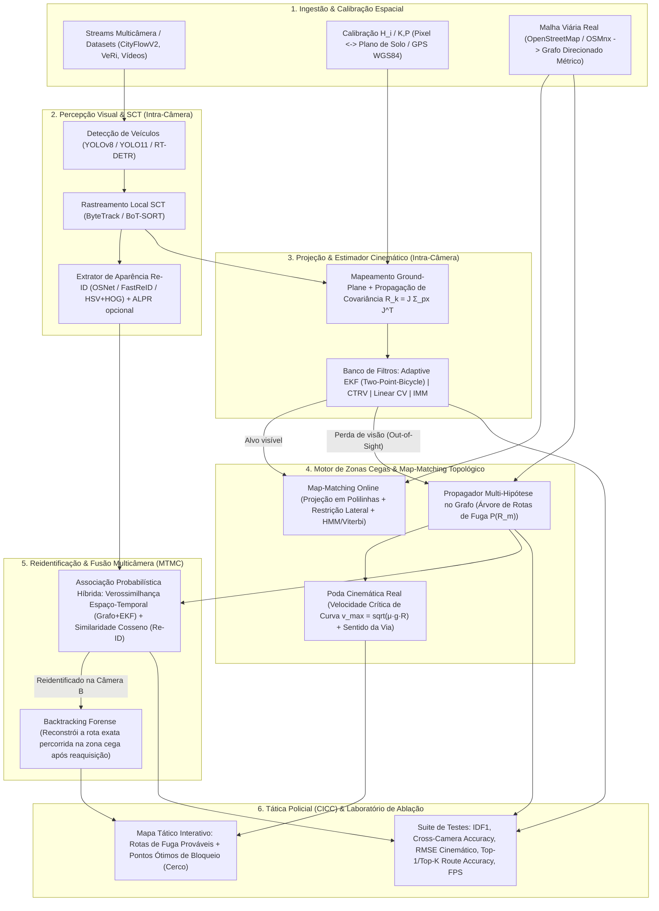

# Plano Arquitetural e Científico: Sistema de Monitoramento Multicâmera e Predição de Rotas de Fuga

> [!IMPORTANT]
> Este plano foi desenhado após a leitura integral do artigo base (`Modelagem Cinemática Não Linear com Filtro de Kalman Estendido e Restrições Topológicas para Predição de Rotas de Fuga em Redes Urbanas de Videovigilância Policial.pdf`) e auditoria completa do código do repositório.

---

## 1. Diagnóstico do Código Legado (Por que refatorar do zero?)

O código legado inicial (`v0.1`) era um protótipo simplificado que continha falhas estruturais e matemáticas graves que invalidavam testes em cenários reais:

1. **Propagação Cega Falsa (`_predicted_blind_position`)**: Em `pipeline/pipeline.py`, quando o veículo entrava em zona cega (`mode == "blind"`), o código legado **não** propagava o EKF passo a passo nem propagava a matriz de covariância $\mathbf{P}$ ao longo das bifurcações do grafo. Ele simplesmente congelava o estado na saída da câmera e interpolava uma linha reta com velocidade constante (`distance = speed * dt`) sobre a primeira rota.
2. **Vazamento de Dados do Futuro e Rastreador Local Ingênuo ("Oráculo")**:
   - O método legado `_build_seeds()` lia o dataset inteiro do futuro antes de rodar o filtro para pré-calcular velocidades, sendo inviável em streaming/tempo real.
   - Em `pipeline/video.py`, o rastreador intra-câmera (`IoUTracker`) usava apenas IoU puro sem predição de movimento ou aparência, quebrando o ID em qualquer oclusão de poste ou cruzamento.
3. **Ausência de Re-Identificação Visual (Re-ID) e OCR**: Em `pipeline/association.py`, a associação entre câmeras usava apenas posição prevista $(X, Y)$ e largura/comprimento aparente da caixa 2D projetada por homografia $(W, L)$. Como uma bounding box 2D inclui a altura do carro, projetar $W$ e $L$ no chão via homografia planar distorce o tamanho dependendo do ângulo da câmera. Sem *embeddings* visuais (Re-ID) ou leitura de placa (ALPR), o sistema confundia veículos distintos que passassem na esquina na mesma janela de tempo.
4. **Física Incorreta na Poda de Conversões**: Em `pipeline/roadgraph.py`, `max_turn_rad` dividia o comprimento total da rua seguinte (`edge_length`, ex: 100 metros) pelo raio mínimo de giro ($R = l/\tan\phi_{\max} \approx 3.5\text{ m}$), concluindo que em qualquer rua de mais de 11 metros era possível virar $180^\circ$, tornando a poda cinemática inócua.
5. **Grafo e Vídeos Sintéticos Simplificados**: O gerador em `pipeline/synthetic.py` desenhava retângulos verdes em fundo cinza (`render_videos`), e os vídeos reais (`kitti_inference.mp4`) usavam uma homografia sintética sobre um grafo em grade (`grid_graph`) que não correspondia às ruas do vídeo.

---

## 2. Hipóteses do Artigo que Precisam ser Testadas (Validação Científica)

As próprias ideias do artigo precisam ser colocadas à prova experimentalmente. O artigo combina três trabalhos clássicos — *Lou et al. (2002)* (Two-Point-Bicycle + Fading EKF), *Chilgunde et al. (2004)* (Homografia + Associação Gaussiana em regiões cegas) e *Chao et al. (2020) / Kinderby (2024)* (Map-Matching em grafo) — e apresenta desafios práticos nessa junção:

| Ideia do Artigo | O Problema / Limitação na Prática | Como Testar (Experimento / Ablação) |
| :--- | :--- | :--- |
| **1. Modelo Two-Point-Bicycle com 5 estados $[x, y, v, \theta, \phi]$** | Câmeras de vigilância não observam o ângulo das rodas dianteiras ($\phi$). Com apenas medições $(x, y)$, o estado $\phi$ tem **observabilidade fraca** e pode divergir com ruído de bbox. | **Teste A1:** Comparar `Two-Point-Bicycle EKF` vs. `CTRV (Constant Turn Rate and Velocity)` vs. `CV (Linear Kalman)` vs. `IMM (Interacting Multiple Model)` em curvas bruscas com apagão visual. |
| **2. Fator de Desvanecimento $\lambda_k$ com $\alpha = (0.1, 0.1, 2.8)$** | Como $\theta$ não é medido diretamente pelo YOLO (é derivado de $\Delta y / \Delta x$ ou de pose 3D), um peso $\alpha_\theta = 2.8$ sobre um $\theta$ ruidoso pode explodir $\lambda_k$ em falsas manobras (jitter da bounding box). | **Teste A2:** Medir RMSE de trajetória com $\lambda$ adaptativo vs. $\lambda=1$ fixo sob diferentes níveis de ruído de detecção e avaliar filtros de estabilização angular. |
| **3. Projeção do Centro da Base da BBox 2D via Homografia Planar** | O centro inferior da bbox 2D (`bottom_center`) não é o centro do eixo traseiro do carro no chão — em câmeras anguladas, a perspectiva 3D desloca o ponto em até 1.5–3 metros. | **Teste A3:** Comparar projeção de `bottom_center` 2D bruto vs. ponto de contato corrigido para o eixo traseiro com matrizes $\mathbf{K}, \mathbf{R}, \mathbf{t}$. |
| **4. Associação Intercâmeras Puramente Cinemática + Tamanho $(X, Y, W, L)$** | Em zonas cegas longas (> 15s) com semáforos e múltiplos carros a velocidades parecidas, a elipse de covariância do EKF cobre dezenas de veículos. | **Teste A4:** Medir `IDF1` e `Cross-Camera Accuracy` usando: (a) Limiar fixo $M \le 350$ do artigo; (b) $\chi^2$ Cinemático + Grafo; (c) Só Re-ID visual; (d) **Fusão Híbrida EKF + Grafo + Re-ID Visual**. |
| **5. Propagação Unimodal na Zona Cega vs. Múltiplas Hipóteses no Grafo** | Quando o veículo entra numa região cega e passa por 2 ou 3 cruzamentos sem câmera, um único estado EKF $\hat{X}$ não consegue se dividir em duas ruas ao mesmo tempo. | **Teste A5:** Implementar **Multi-Hypothesis EKF sobre Grafo (Graph-Constrained MHT)** com poda por velocidade crítica de curva + Map-Matching HMM/Viterbi e recomendação de pontos de bloqueio policial. |

---

## 3. Arquitetura Ponta a Ponta (Design do Sistema)

Arquitetura modular dividida em **6 Camadas Desacopladas**, operando tanto em **tempo real (streams RTSP/vídeos)** quanto em **modo benchmark científico**:

### Detalhamento das Melhorias Chave da Arquitetura:

1. **Map-Matching Real com OpenStreetMap (`OSMnx`)**:
   - Baixa automaticamente o grafo viário real de qualquer coordenada GPS (ou do benchmark CityFlowV2 em Ames/Iowa), convertendo para coordenadas métricas UTM (metros), extraindo polilinhas curvas reais das ruas, número de faixas, sentido único (`oneway`) e velocidade máxima regulamentar (`maxspeed`).
2. **Poda Física Realista em Cruzamentos**:
   - A viabilidade de um veículo em fuga fazer uma curva num cruzamento depende do **raio de curvatura da interseção ($R_{\text{curva}}$)** e da **velocidade instantânea estimada pelo EKF ($v_k$)**:
     $$v_{\text{crit}} = \sqrt{\mu_{\text{atrito}} \cdot g \cdot R_{\text{curva}}}$$
   - Se o veículo está em alta velocidade aproximando-se de uma esquina fechada de $90^\circ$ sem desaceleração compatível, a probabilidade de conversão naquela esquina cai drasticamente a favor de seguir na via arterial.
3. **Propagação Multi-Hipótese na Zona Cega (`BlindHypothesis`)**:
   - Quando o veículo sai do campo de visão da Câmera $A$, o estado do EKF é projetado na aresta atual do grafo. Ao atingir um nó de bifurcação $v_0$ dentro da zona cega, o filtro **ramifica** em hipóteses filhas para cada aresta viável $e_j \in \text{Out}(v_0)$, propagando a posição ao longo do comprimento curvilíneo $s$ da via e expandindo a covariância anisotrópica no sentido longitudinal da pista.
4. **Fusão Espaço-Temporal + Re-ID Visual**:
   - A pontuação de associação entre um veículo perdido $a$ e um veículo recém-detectado $b$ na Câmera $B$ combina a distância de Mahalanobis espaço-temporal (ao longo das rotas propagadas no grafo) com a distância de cosseno do vetor de aparência Re-ID ($\mathbf{f}_a, \mathbf{f}_b$):
     $$S(a, b) = (1 - w_{\text{app}}) \cdot \chi^2_{\text{EKF+Grafo}}(X_b, t_b \mid \hat{X}_a, t_a) + w_{\text{app}} \cdot d_{\cos}^2(\mathbf{f}_a, \mathbf{f}_b)$$

---

## 4. Ecossistema de IAs Pré-Treinadas, Ferramentas e Datasets

### 4.1. Modelos Pré-Treinados e Ferramentas Open-Source

| Etapa da Pipeline | Ferramenta / Modelo Recomendado | Por que usar? |
| :--- | :--- | :--- |
| **Detecção 2D** | **YOLO11 / YOLOv8** (`ultralytics`) ou **RT-DETR** | Pesos pré-treinados em COCO/VisDrone/UA-DETRAC; execução em tempo real com suporte a CPU, CUDA e ONNX. |
| **Rastreamento Intra-Câmera (SCT)** | **BoT-SORT** ou **ByteTrack** (`pipeline/video.py` / `boxmot`) | Resolve oclusões locais dentro da mesma câmera combinando predição de movimento + associação em 2 estágios + Re-ID. |
| **Re-Identificação de Veículos (Re-ID)** | **OSNet / ResNet50-IBN** (treinados em **VeRi-776** / **CityFlow**) + Descritor Part-Based HSV/HOG | Gera um vetor *embedding* invariante ao ângulo da câmera para diferenciar veículos similares após a zona cega. |
| **Malha Viária & Grafos** | **OSMnx** + **NetworkX** + **Shapely** | Extrai qualquer cidade real do OpenStreetMap com geometria métrica UTM, sentidos de via e limites de velocidade. |
| **Map-Matching Benchmark** | **HMM / Viterbi** (`RoadGraph.hmm_viterbi_match`) | Implementação do modelo HMM citado na Tabela da Seção 4 do artigo, servindo como *baseline* e filtro de sequência. |

### 4.2. Estratégia de Datasets (Referências do Projeto)

| Dataset | Descrição | Aplicação no Projeto | Link Oficial |
| :--- | :--- | :--- | :--- |
| **CityFlow / CityFlowV2** | Rastreamento de veículos entre 46 câmeras urbanas não sobrepostas com GPS e homografia | **Benchmark Principal:** Avaliação ponta a ponta de correspondência intercâmeras, EKF e rotas em zonas cegas. | [GitHub CityFlow](https://github.com/cityflow-project/CityFlow) · [AI City Challenge](https://www.aicitychallenge.org/) |
| **AI City Challenge 2022 – Track 1** | Rastreamento multicâmera de veículos em rodovias e cruzamentos urbanos | Avaliação de escalabilidade, vazão em FPS e IDF1 global. | [AI City Challenge](https://www.aicitychallenge.org/) |
| **VeRi-776** | Reidentificação de 776 veículos em 20 câmeras sob diferentes ângulos e iluminações | Treinamento e validação do extrator de aparência `VehicleReIDExtractor` (`pipeline/reid.py`). | [VeRi Dataset](https://vehiclereid.github.io/VeRi/) |
| **UA-DETRAC** | Vídeos de trânsito urbano com veículos anotados em câmeras de vigilância elevadas | Teste de filtragem cinemática não linear com **máscara artificial de zona cega** no meio de curvas. | [UA-DETRAC](https://detrac-db.rit.albany.edu/) |
| **RoundaboutHD** | 4 câmeras 4K não sobrepostas em rotatória urbana com geometria de câmera | Validação de modelos não lineares (Two-Point-Bicycle e CTRV) em trajetórias curvilíneas contínuas. | [GitHub RoundaboutHD](https://github.com/siri-rouser/RoundaboutHD) |
| **Kaggle & Roboflow Universe** | Datasets públicos de vídeos CCTV, trânsito e reconhecimento de placas (ALPR) | Testes complementares de detecção YOLO, vídeos ANPR e validação de câmeras municipais. | [Kaggle Datasets](https://www.kaggle.com/datasets) · [Roboflow Universe](https://universe.roboflow.com/) |

---

## 5. Roadmap de Implementação em Fases

- **Fase 1 — Fundação Geométrica e Malha Viária Real (`pipeline/geometry.py` & `pipeline/roadgraph.py`)**:
  - Projeção homográfica planar ($\mathbf{H}$) e volumétrica ($\mathbf{K}, \mathbf{R}, \mathbf{t}$) + incerteza métrica e correção de perspectiva 3D da bounding box.
  - Grafo direcionado métrico com interpolação curvilínea, cálculo de raios de curvatura nas interseções e importação do OpenStreetMap (`OSMnx`).
- **Fase 2 — Laboratório de Filtragem Cinemática (`pipeline/kinematics.py` & `pipeline/ekf.py`)**:
  - Implementação lado a lado e na mesma interface de:
    1. `LinearKalmanCV` (Baseline linear para provar a tese da Seção 2.1 do artigo);
    2. `CanonicalBicycleEKF` ($\lambda = 1$);
    3. `AdaptiveEKF` (*Two-Point-Bicycle* de *Lou et al., 2002* com critério de ortogonalidade e proteção contra jitter angular);
    4. `CoordinatedTurnEKF` (CTRV de *Bradler et al., 2021*) e `IMMFilter`.
- **Fase 3 — Motor de Zonas Cegas, Poda Física e Árvore de Fuga (`pipeline/roadgraph.py` & `pipeline/pipeline.py`)**:
  - Map-matching contínuo, HMM/Viterbi e propagador multi-hipótese ao longo das polilinhas do grafo durante o apagão visual (*out-of-sight*).
  - Poda cinemática baseada em velocidade crítica de curva + sentido da via + geração da árvore probabilística $P(R_m)$ e recomendação de pontos de bloqueio policial (Cerco Tático CICC).
- **Fase 4 — Percepção Visual e Associação Multicâmera (`pipeline/reid.py`, `pipeline/video.py` & `pipeline/association.py`)**:
  - Pipeline de vídeo 100% causal com `YOLO` + `ByteTrack` em 2 estágios + extração de embeddings `Re-ID`.
  - Associação intercâmeras comparando a métrica puramente cinemática do artigo ($M \le 350$) vs. $\chi^2$ Cinemático vs. Re-ID puro vs. Fusão Híbrida (Cinemática + Grafo + Re-ID) + Backtracking Forense de rota.
- **Fase 5 — Suite de Experimentos, Datasets e Dashboard Visual (`pipeline/experiments.py` & `pipeline/visualizer.py`)**:
  - Execução automatizada dos **5 Testes Científicos (A1 a A5)** gerando `ablation_results.json`, integração com datasets públicos reais e renderização do vídeo tático *Split-Screen* CICC.
